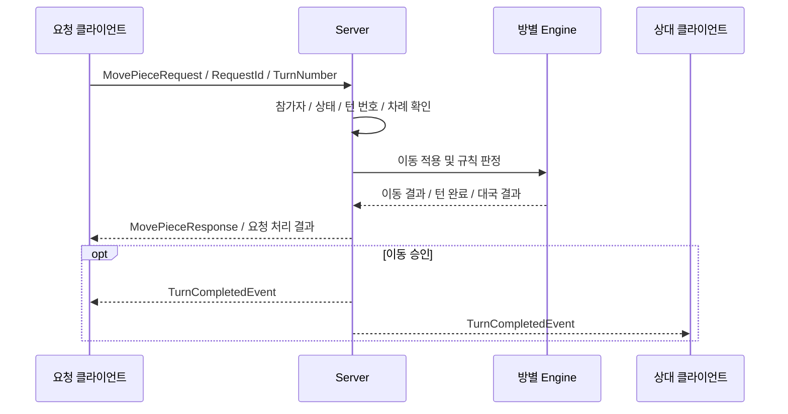

<h3 align="center">Tech Stack</h3>

<p align="center">
  
  
  
  
  
</p>

<p align="center">
  C# / .NET 10 / TCP / Length-Prefixed JSON / NuGet / MSTest<br />
  GitHub Actions / AWS EC2 / Ubuntu / OIDC / SSH / SCP / systemd
</p>

# YuJanggi.Server

Windows / Android Unity 클라이언트의 1:1 온라인 장기 대국을 처리하는 .NET TCP 서버입니다.
방마다 공용 `YuJanggi.Engine`을 실행해 대국 상태를 확정하며, AWS EC2의 Ubuntu 환경에 배포합니다.

## Highlights

- **서버 권위 대국**: 참가자와 차례를 확인하고 Engine으로 이동의 합법성과 대국 결과를 판정
- **턴 동기화**: 요청의 턴 번호를 검증하고, 확정된 턴과 다음 차례의 마감 시각을 양쪽 클라이언트에 전달
- **서버 시간 관리**: 턴당 60초 제한시간을 진행하고 시간 초과 시 한 수 쉼 처리
- **매칭부터 리매치까지**: FIFO 매칭 / 포진 선택 / 게임 씬 준비 / 대국 종료 / 양측 동의 후 재대결
- **배포 자동화**: GitHub Actions에서 검증한 Linux 실행 Artifact를 EC2에 배포하고 systemd 서비스 갱신

## 로컬 실행

.NET 10 SDK와 GitHub Packages 읽기 인증이 필요합니다.
[NuGet.Config](NuGet.Config)에 따라 공용 패키지를 GitHub Packages에서 복원합니다.

현재 [서버 프로젝트](src/YuJanggi.Server.csproj)는 `YuJanggi.Engine 2.8.4` / `YuJanggi.Protocol 1.8.0`을 참조합니다.
클라이언트는 Handshake에서 Engine / Protocol 버전이 서버와 일치해야 합니다.

`NuGetPackageSourceCredentials_github` 환경변수 등으로 로컬 인증을 설정한 뒤 저장소 루트에서 실행합니다.

```bash
dotnet restore YuJanggi.Server.slnx --configfile NuGet.Config
dotnet run --project src/YuJanggi.Server.csproj --no-restore
```

- **접속 주소**: 서버는 `0.0.0.0:7777`에서 수신합니다. 같은 PC의 클라이언트는 `127.0.0.1:7777`, 다른 기기는 서버 PC의 접근 가능한 IP로 연결합니다.
- **시작 로그**: 실행 중인 Engine / Protocol 버전을 출력합니다.
- **콘솔 명령**: `Rooms`로 방과 참가자를 조회하고, `Clear`로 콘솔 출력을 지웁니다. 표준 입력이 없는 systemd 실행에서는 사용할 수 없습니다.

## 대국 흐름

1. **연결 / Handshake**: 세션을 등록하고 공용 패키지 버전을 비교합니다. Handshake 완료 후 매칭을 요청할 수 있습니다.
2. **매칭 / 포진**: FIFO 대기열에서 두 참가자를 확정합니다. 양측 포진을 모두 접수하면 GameRoom과 Engine을 생성합니다.
3. **준비 / 시작**: 양쪽 게임 씬 준비를 확인한 뒤 `WaitingForReady → Playing`으로 전환하고 첫 차례와 마감 시각을 알립니다.
4. **진행 / 종료**: 이동과 한 수 쉼을 검증하고 확정된 턴을 전달합니다. Engine 판정 또는 기권으로 종료되면 서버가 승자 / 총 수순 / 종료 사유를 전달합니다.
5. **리매치 / 연결 종료**: `Ended` 상태에서 양측 리매치 요청을 모아 준비 상태로 돌아갑니다. 다시 시작할 때 Engine을 초기화하며, 연결이 끊기면 관련 세션 / 매칭 / 방을 정리합니다.

### 요청과 확정 이벤트



이동이 거절되면 확정 이벤트를 보내지 않습니다.
종료 결과가 발생하면 턴 완료 이벤트 이후 `GameEndedEvent`를 전달합니다.
클라이언트가 제출한 일반 종료 결과는 수락하지 않으며, 기권도 실제 세션의 참가자 정보를 기준으로 처리합니다.

### 시간 진행 / 채팅

서버는 50ms 간격의 루프와 인게임 요청 처리 직전에 경과 시간을 Engine에 전달합니다.
시간 초과로 완료된 턴에는 `ProtocolPassReason.Timeout`, 사용자가 요청한 한 수 쉼에는 `UserRequest`를 담습니다.

채팅은 같은 방의 참가자에게 전달합니다.
공백과 최대 길이를 검사하고 세션별 전송 간격을 1초로 제한합니다.

## Architecture

- **Transport / Connection**: TCP 메시지 송수신 / 세션 등록과 해제. Protocol의 직렬화와 길이 헤더 프레이밍을 사용하며, 세션별 송신을 직렬화합니다.
- **Handler**: 메시지와 RequestId 검증 / Service 호출 / Response와 Event 생성 및 전송
- **Service**: 요청 수락 판단 / 참가자 확인 / 매칭과 대국 상태 전환 조정
- **Manager / 상태 객체**: 세션과 방 컬렉션 관리 / `MatchState`의 매칭 상태 / `GameRoom`의 방별 Engine과 대국 상태 관리
- **Core**: `IClientSession` / `IMessageHandler` 등 공통 계약과 요청 검증
- **Server**: 객체 연결 / 메시지 라우팅 / 시간 진행 루프 / 연결 종료와 서버 종료 시 정리

기능 코드는 `Features/Login` / `Features/Lobby` / `Features/Game`으로 구분하며, 채팅은 Game 내부에 둡니다.
Handshake는 버전 호환성 검사이며 사용자 인증을 대신하지 않습니다.

[GameHandler](src/Features/Game/Handler/GameHandler.cs)는 방별 작업 큐로 인게임 요청과 Tick 처리 순서를 유지합니다.
[GameService](src/Features/Game/Service/GameService.cs)는 방 잠금 안에서 상태를 변경하고, Handler가 잠금 밖에서 메시지를 전송합니다.
[GameRoom](src/Features/Game/GameRoom.cs)은 Engine의 현재 차례와 기록을 기준으로 턴 번호를 확인하며, 이전 턴의 이동 / 한 수 쉼 요청을 거절합니다.

## CI/CD

- **[CI](.github/workflows/ci.yml)**: `main` / `release/**` 대상 PR에서 Restore → Release Build → MSTest를 실행합니다.
- **[Release](.github/workflows/release.yml)**: `v*.*.*` 태그에서 같은 검증을 수행한 뒤 Linux x64 실행 Artifact를 생성합니다.
- **[CD](.github/workflows/cd.yml)**: 성공한 Server Release 실행의 Artifact를 내려받아 EC2에 배포합니다. Build / Test / Publish를 다시 수행하지 않습니다.

[PublishServer.sh](scripts/PublishServer.sh)는 framework-dependent 결과물을 생성하므로 배포 대상에 .NET 10 런타임이 필요합니다.
[DeployServer.sh](scripts/DeployServer.sh)는 Host Key를 검증하며 SSH / SCP로 파일을 전달한 뒤 `yujanggi` 서비스를 재시작하고 활성 상태를 확인합니다.

AWS 접근에는 GitHub OIDC를 사용합니다.
배포 중에는 Runner IPv4 `/32`에만 SSH를 임시 허용하고, 후처리 단계에서 생성한 Security Group Rule ID로 규칙을 제거합니다.

## 테스트 / 남은 작업

[YuJanggi.Server.Tests](YuJanggi.Server.Tests)에 다음 MSTest를 작성했습니다.

- **Connection**: Handshake 전 매칭 차단 / 연결 종료 시 세션과 대기열 정리
- **Lobby**: FIFO / 매칭 취소 / 응답과 매칭 이벤트 순서 / 양측 포진 제출 / 동시 요청과 전송 실패 처리
- **Game**: 이동 응답과 확정 이벤트 순서 / 서버 턴 정보 / 오래된 턴 요청 거절 / 기권 시 서버 결과 확정 / 동시 종료 / 리매치 초기화

서버 시간 초과 처리와 Engine 종료 결과의 통합 검증, 채팅 테스트는 추가할 영역입니다.
사용자 인증 / DB 연동 / 상대 이탈 알림 / 재접속 복구와 일부 이벤트 전송 실패 정책도 남아 있습니다.
배포에는 자동 롤백과 Runner 강제 종료 시 임시 SSH 규칙 회수 보완이 필요합니다.

## 관련 문서 / 프로젝트

- [Ubuntu EC2 systemd 설정 가이드](docs/systemd-ec2-ubuntu.md) / [서비스 파일 예시](docs/deploy/systemd/yujanggi.service)
- [YuJanggi.Unity](https://github.com/SeokJinYoo98/YuJanggi.Unity) — 게임 입력 / 화면 표현 / 클라이언트 네트워크 처리
- [YuJanggi.Engine](https://github.com/SeokJinYoo98/YuJanggi.Engine) — Unity와 서버가 공유하는 장기 규칙 / 대국 상태 / 턴 처리
- [YuJanggi.Protocol](https://github.com/SeokJinYoo98/YuJanggi.Protocol) — 공용 메시지 계약 / 직렬화 / 패킷 프레이밍
